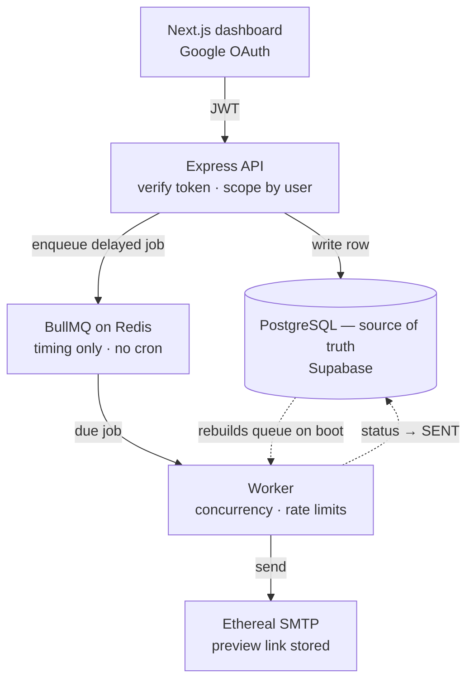

# Outbox — Email Scheduler

A full-stack email scheduler built for the Outbox Labs / ReachInbox SDE internship
assignment: schedule emails via API, deliver them through a persistent BullMQ+Redis
queue (no cron), and manage everything from a Next.js dashboard.

- **Live dashboard** — https://outbox-labs-frontend-bay.vercel.app/login
- **Demo video** — https://www.youtube.com/watch?v=AjfkaPkFWV0

The API runs on Render's free plan, which idles the process out after about fifteen
minutes. The first request after a quiet spell takes a few seconds while it wakes.

## Architecture at a glance



Postgres owns the truth; Redis only owns the timing. Wipe Redis and the worker rebuilds
the queue from Postgres on its next boot, which is what stops a restart losing mail.

## Stack

- **Backend**: Express + TypeScript, BullMQ (Redis-backed queue), Prisma → PostgreSQL
  (Supabase), Ethereal for fake SMTP.
- **Frontend**: Next.js 16 (App Router) + TypeScript + Tailwind CSS v4, Supabase Auth
  (Google OAuth) for login, Tiptap for the rich-text composer.
- **Infra**: Redis via Docker for local dev, Cloudinary for attachment storage,
  OpenRouter for the compose assistant.

## Running it locally

### 1. Redis

```bash
docker compose up -d redis
```

### 2. Backend

```bash
cd backend
cp .env.example .env       # fill in DATABASE_URL/DIRECT_URL (Supabase), SUPABASE_URL,
                            # ETHEREAL_USER/PASS (generate at https://ethereal.email), etc.
npm install
npm run prisma:push        # creates the tables in their own `scheduler` schema
npm run dev                # API on :4000
```

The tables live in a dedicated `scheduler` Postgres schema rather than `public`, so the
app can share a Supabase project with something else without either one touching the
other's tables.

In a second terminal — also from `backend/` — start the queue worker as its own
process. This is what makes restart-survival possible: the worker can be killed and
restarted independently of the API.

```bash
npm run dev:worker
```

Every backend command in this README runs from `backend/`. The repository root only
carries workspace wiring, so `npm run reset` there fails with `Missing script`.

If the API exits with `EADDRINUSE ... :4000`, an earlier run is still holding the port:

```bash
npx kill-port 4000
```

### 3. Frontend

```bash
cd frontend
cp .env.local.example .env.local   # fill in Supabase project URL/anon key
npm install
npm run dev                        # http://localhost:3000
```

Enable the Google provider under Supabase → Authentication → Providers, and add
`http://localhost:3000/auth/callback` as an allowed redirect URL.

## Deploying

Four pieces: the dashboard on Vercel, the API on Render, Redis on Upstash, Postgres on
Supabase (already hosted).

**1. Redis** — create a free Upstash database and copy its `rediss://` URL.

**2. API on Render** — the repo has a `render.yaml`, so "New → Blueprint" picks the
service up. Set the secrets listed in `.env.production.example` in the dashboard, with
`CORS_ORIGIN` pointing at the deployed dashboard.

Render's free plan runs one process per service, so `RUN_WORKER_IN_API=true` starts the
queue worker inside the API. Locally the worker stays a separate process, which is what
makes killing it a meaningful restart test.

**3. Dashboard on Vercel** — import the repo, set the root directory to `frontend`, and
add `NEXT_PUBLIC_SUPABASE_URL`, `NEXT_PUBLIC_SUPABASE_ANON_KEY` and `NEXT_PUBLIC_API_URL`
(the Render URL).

**4. Point auth at the deployed URLs** — add `https://<app>.vercel.app/auth/callback` to
Supabase → Authentication → URL Configuration, and keep the Supabase callback in the
Google Cloud client's authorised redirect URIs.

### A note on free tiers

Render's free Key Value instance keeps data in memory only, so Redis can be emptied at
any time — which on its own would wipe every pending job. It doesn't, because Postgres
is the source of truth and the worker rebuilds the queue from it on boot. Wiping Redis
with emails still due two minutes out and restarting the worker re-queues them and they
go out within a few seconds of their original time, rather than early or not at all.

Render's free web services idle out after about 15 minutes and take a few seconds to
wake. A sleeping process can't send an email at its scheduled moment, so on a cold start
sends run late. Nothing is lost: the reconciliation sweep runs on boot, finds everything
that came due while the process was down, and sends it immediately — the same mechanism
that makes the restart test pass. A paid instance, or any always-on host, removes the
delay entirely.

## Architecture

### Scheduling (no cron)

Scheduling an email inserts a `ScheduledEmail` row in Postgres, then enqueues a BullMQ
delayed job (`delay: scheduledFor - now`) in the `email-send` queue, using the row's
`id` as the job's `jobId`. The job just sits in Redis until its delay elapses — there's
no polling loop or cron tick driving this.

### Persistence across restarts

Delayed jobs live in Redis (persisted via `appendonly yes`), so killing/restarting
either the API or the worker process doesn't lose them. Two extra layers make sure
nothing falls through the cracks:

- **BullMQ's stalled-job recovery** (`stalledInterval`/`maxStalledCount`) retries a job
  automatically if the worker holding its lock dies mid-processing.
- **A reconciliation sweep** (`backend/src/services/reconcile.ts`) re-queues anything
  the database still expects to send but Redis has no job for. The five-minute pass
  looks only at overdue emails, which is cheap and covers an enqueue that failed after
  the row was committed, or a worker that died mid-send. The boot pass also takes in
  future emails, so a Redis that lost its data is rebuilt from Postgres immediately
  rather than one email at a time as each falls overdue.

### Idempotency

Two independent checks prevent double-sends:
1. BullMQ dedupes on `jobId` (the row's own id) — re-adding the same job is a no-op.
2. The worker re-checks the row's `status` before processing, and atomically claims it
   with `UPDATE ... WHERE status = 'SCHEDULED'` before sending. Any retried/duplicated
   job attempt sees a `status` that's no longer `SCHEDULED` and short-circuits.

### Rate limiting & concurrency

- **Worker concurrency**: `WORKER_CONCURRENCY` env var, passed straight into BullMQ's
  `Worker` options.
- **Minimum delay between sends**: a Redis key per sender (`rl:lastsent:{senderId}`)
  set with `SET NX PX <minDelayMs>`. If a job is processed before that key expires, the
  minimum delay hasn't passed yet.
- **Emails per hour**: a Redis counter per sender per hour bucket
  (`rl:hour:{senderId}:{YYYYMMDDHH}`), incremented atomically and expired after ~1
  hour. Both are Redis-backed (not in-memory), so they're safe across multiple worker
  processes.
- **What happens when a limit is hit**: the job is never dropped or failed. The worker
  calls `job.moveToDelayed(...)` to push it to the next hour boundary (for the hourly
  limit) or to just after the delay window closes (for the minimum delay), and reverts
  the row back to `SCHEDULED` in the meantime. This is also how a burst of 1000+ emails
  scheduled at once behaves — every job still gets a cheap delayed slot in Redis, and
  the rate limiter naturally spreads the actual sends out over time instead of erroring.

### Compose assistant and merge tags

The magic-wand button sends the current draft to an LLM (OpenRouter, `openai/gpt-4o-mini`
by default) and swaps in a rewritten version: a greeting, short paragraphs, and a
sign-off carrying the signed-in user's name. It rewrites the subject too, and fixes
spelling and grammar without inventing facts or touching existing tags. The replacement
runs through the editor's history, so Ctrl+Z brings the original back.

Because one draft goes to a whole list, the greeting uses `{{firstName}}` rather than a
literal name. The worker fills tags per recipient at send time, deriving the name from
the address — `john.smith@…` becomes "John", while shared mailboxes like `support@…`
fall back to "there" so the greeting still reads naturally. `{{name}}` and `{{email}}`
work the same way, and the assistant deliberately keeps tags out of the subject, where
that fallback would read badly.

Both the key and model are env-driven, the endpoint carries its own tighter rate limit,
and the button disappears when `OPENROUTER_API_KEY` is unset.

### Senders and tenancy

Every account is provisioned its own set of mailboxes (`DEFAULT_SENDERS`) the first time
the dashboard asks for them, and a schedule request resolves the sender by id *and*
owner — so one account can neither read another's emails nor send from their address.
Rate limits are keyed per sender, which is what makes having several of them useful.

### Auth

The frontend signs in through Supabase's Google provider and sends the resulting session
JWT as a bearer token on every API call. The backend verifies it against the Supabase
project's public JWKS endpoint (`/auth/v1/.well-known/jwks.json`) rather than a shared
secret — newer Supabase projects sign with rotatable ES256 keys, so there's no symmetric
secret to distribute, and key rotation is handled for us. Every `/api/*` route except
the health check goes through that middleware.

Signing in with Google and with a password resolve to the same account: Supabase links
identities that share a verified email address, so the token's `sub` — which every row
is keyed on — stays the same either way. The verified part matters. An account created
while "Confirm email" is on but never confirmed can neither sign in nor be linked, since
linking to an unverified address would allow pre-account-takeover.

## Seeing it work

Every send goes through Ethereal, which captures the message and returns a preview link
instead of delivering to a real inbox. That link is stored on the row and surfaced as a
**View email** button in the Sent tab, so you can open the actual rendered message —
body, formatting and attachments included.

To watch the rate limiter under load, schedule a burst against a deliberately low limit:

Run these from `backend/`. Anything taking arguments goes through `npx tsx` directly —
npm swallows the arguments after `--` when the package is a workspace member:

```bash
npx tsx scripts/loadtest.ts 1000 50 0   # 1000 emails against a 50/hour limit
npm run status                          # counts, next send times, Redis counters
npm run loadtest:clear                  # remove just the load-test rows
npx tsx scripts/reset.ts --all          # clear everything, including the queue
```

`reset` needs a target — either a user id or `--all` — so it can't wipe real data by
accident.

Running that 1000-email burst gives exactly 50 sent, 950 left `SCHEDULED` with their
next attempt moved to the following hour, and nothing in `FAILED`.

`npm run status` prints the Redis hour-bucket counters directly, which is the clearest
way to show the limit being enforced: the bucket stops at the configured maximum and the
remaining emails sit in `SCHEDULED` with their next attempt moved to the following hour
— none of them fail or disappear.

## Features implemented

**Backend**: schedule API (single + CSV batch), paginated scheduled/sent listings,
BullMQ delayed-job scheduling, configurable worker concurrency, per-sender min-delay and
hourly rate limiting (Redis-backed, env-configurable, never drops jobs), two-layer
idempotency, restart-persistence via BullMQ plus a reconciliation sweep, Supabase JWT
auth middleware, CSV/txt recipient parsing, Cloudinary-backed attachments, an LLM
draft assistant, and stored Ethereal preview links.

**Frontend**: Google OAuth via Supabase Auth, dashboard with Scheduled/Sent tabs showing
recipient, subject, timestamp and status, with loading / empty / error states, search,
status filtering and "load more" pagination; lists poll every 10s so emails visibly move
from Scheduled to Sent. Compose is a Gmail-style modal (expandable to full screen) with
sender selection, recipient chips, CSV upload with a parsed count, rich-text body,
attachments with thumbnails, a date/time picker, and configurable delay and hourly
limit, plus a one-click assistant that polishes the draft. Rows can be starred, which
persists. Toasts cover success and error paths throughout.

## Assumptions & trade-offs

- **User info sits in the sidebar, not a top header.** The written brief says "top
  header" but the Figma places name, email and avatar in the left sidebar, and the same
  brief says to follow the Figma closely. All four required elements (name, email,
  avatar, logout) are present — the Figma's placement won.
- Email/password sign-in and sign-up both work through Supabase Auth, including the
  confirmation-email case. Google OAuth remains the primary path, since that's what the
  assignment requires. Password reset isn't built — it needs an email template and a
  reset route, and no requirement asked for it.
- The rich-text editor is Tiptap (ProseMirror). It started as a `contentEditable` +
  `document.execCommand` toolbar, but `execCommand` is deprecated and can't report
  active state reliably — `queryCommandState("justifyLeft")` returns `true` even when
  nothing is aligned, so the button was permanently highlighted. Tiptap tracks real
  document state, so every toolbar button lights up only when it actually applies.
- Attachments upload to Cloudinary as the user picks them, so the database and the job
  payload only ever carry a URL, and nodemailer streams each file straight from storage
  when the email goes out. Uploaded files aren't garbage-collected when an email is
  deleted — a scheduled cleanup pass would be the next step.
- The dashboard polls every 10 seconds rather than holding a connection open. It pauses
  on hidden tabs, which is enough for one operator; server-sent events would be the
  right answer for many concurrent users.
- Starring a row is local UI state only — there's no `starred` column, since the
  requirements don't ask for it.
- The optional "open a full email thread" view from the Figma file wasn't built — it's
  not part of the written requirements, and the two required tables were prioritized.
- The API is rate limited per IP (`RATE_LIMIT_PER_MINUTE`) so a valid token isn't a
  licence to hammer it, and attachment sizes are capped server-side rather than trusting
  the browser's check.
- Local dev uses Docker Redis; a hosted Redis (e.g. Upstash) would be a one-line
  `REDIS_URL` change for a real deployment.
